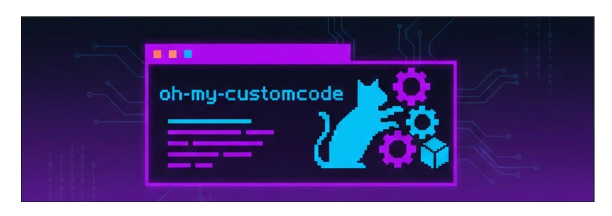
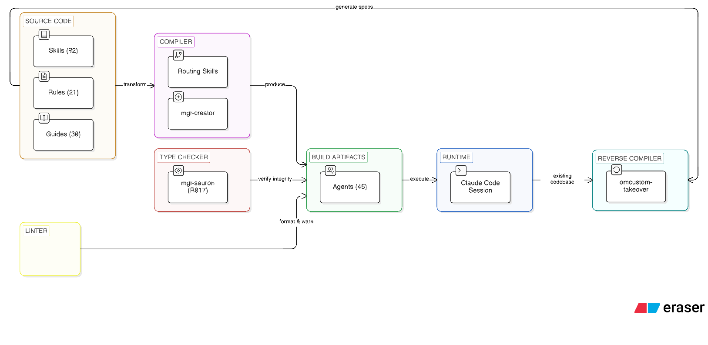
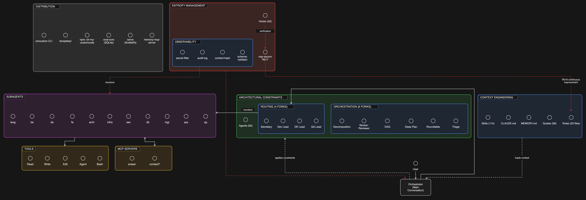

<div align="center">
  
</div>

# oh-my-customcode

> **Your AI Agent Stack. Compiled, Not Configured.**

[](https://www.npmjs.com/package/oh-my-customcode)
[](https://polyformproject.org/licenses/noncommercial/1.0.0/)
[](https://github.com/baekenough/oh-my-customcode/actions/workflows/ci.yml)
[](https://github.com/baekenough/oh-my-customcode/actions/workflows/security-audit.yml)

**[한국어 문서 (Korean)](./README_ko.md)**

50 agents. 114 skills. 23 rules. One command.

```bash
npm install -g oh-my-customcode && cd your-project && omcustom init
```

---

## Philosophy

oh-my-customcode is built on two ideas:

**1. Agent systems are compiled, not configured.**

| Compile Concept | oh-my-customcode |
|----------------|-----------------|
| Source code | `.claude/skills/` — reusable knowledge and workflows |
| Build artifacts | `.claude/agents/` — executable specialists assembled from skills |
| Compiler | `mgr-sauron` (R017) — structural verification and integrity |
| Spec | `.claude/rules/` — constraints and build rules |
| Linker | Routing skills — connect agents to tasks |
| Standard library | `guides/` — shared reference documentation |

Skills are source. Agents are compiled output. Sauron verifies the build. This separation means skills evolve independently of agents, and agents can be recompiled from updated skills at any time.

<p align="center">
  
</p>

**2. If it can't be done, make it work.**

When no specialist exists for a task, oh-my-customcode does not fail. It creates one.

```
User: "Review this Terraform module"
  → Routing: no terraform expert found
  → mgr-creator discovers: infra-aws-expert skills + docker-best-practices guide
  → Creates: infra-terraform-expert.md
  → Executes the review immediately
  → Agent persists for future use
```

This is not a fallback. It is the design. The system treats missing expertise as a build problem — find the right skills, compile a new agent, execute.

---

## How It Works

### Orchestration

The main conversation acts as a singleton orchestrator (R010). It never writes files directly. Every action is delegated through routing skills to specialized agents.

```
User (natural language)
  → Routing skill (intent detection, confidence scoring)
    → Specialized agent (isolated execution)
      → Result returned to orchestrator
        → Response to user
```

Four routing skills cover the full domain:

<p align="center">
  
</p>

| Routing Skill | Routes To |
|--------------|-----------|
| secretary-routing | Manager agents (mgr-*), system agents (sys-*) |
| dev-lead-routing | Language, backend, frontend, tooling, DB, infra, arch agents |
| de-lead-routing | Data engineering agents (de-*) |
| qa-lead-routing | QA team (qa-planner, qa-writer, qa-engineer) |

### Model Selection

Each agent runs on the model optimized for its task:

| Model | When | Examples |
|-------|------|---------|
| `opus` | Complex reasoning, architecture | Design review, research synthesis |
| `sonnet` | Implementation, general tasks | Code generation, agent creation |
| `haiku` | Fast validation, search | File search, count verification |

The reasoning-sandwich pattern formalizes this: opus for pre-analysis, sonnet for implementation, haiku for post-verification.

### Parallel Execution

Independent tasks run in parallel (R009). Up to 4 concurrent agents per message:

```
Agent(lang-golang-expert):sonnet  ┐
Agent(lang-python-expert):sonnet  ├─ All spawned in one message
Agent(qa-engineer):sonnet         │
Agent(arch-documenter):haiku      ┘
```

Soft default is 4 concurrent agents, hard cap 5. Agent Teams (shared task list, peer messaging) is used instead of plain parallel agents when it's available — but it requires Claude Code to expose a `TeamCreate` tool, which is not present on a stock install today. Until then, oh-my-customcode's standard Agent-tool parallel model above is what actually runs.

---

### Agents (50)

| Category | Count | Agents |
|----------|-------|--------|
| Languages | 6 | lang-golang, lang-python, lang-rust, lang-kotlin, lang-typescript, lang-java |
| Backend | 6 | be-fastapi, be-springboot, be-go-backend, be-express, be-nestjs, be-django |
| Frontend | 5 | fe-vercel, fe-vuejs, fe-svelte, fe-flutter, fe-design |
| Data Engineering | 6 | de-airflow, de-dbt, de-spark, de-kafka, de-snowflake, de-pipeline |
| Database | 4 | db-supabase, db-postgres, db-redis, db-alembic |
| Tooling | 4 | tool-npm, tool-optimizer, tool-bun, slack-cli |
| Architecture | 2 | arch-documenter, arch-speckit |
| Agora | 1 | agora-runner |
| Infrastructure | 2 | infra-docker, infra-aws |
| QA | 3 | qa-planner, qa-writer, qa-engineer |
| Security | 1 | sec-codeql |
| Managers | 6 | mgr-creator, mgr-updater, mgr-supplier, mgr-gitnerd, mgr-sauron, mgr-claude-code-bible |
| System | 4 | sys-memory-keeper, sys-naggy, tracker-checkpoint, wiki-curator |

Each agent declares its tools, model, memory scope, and limitations in YAML frontmatter. Tool budgets are enforced per agent type for accuracy.

---

### Skills (114)

| Category | Count | Includes |
|----------|-------|----------|
| Best Practices | 24 | Go, Python, TypeScript, Kotlin, Rust, React, FastAPI, Spring Boot, Django, Flutter, Docker, AWS, Postgres, Redis, Kafka, dbt, Spark, Snowflake, Airflow, pipeline-architecture-patterns, alembic, and more |
| Routing | 4 | secretary, dev-lead, de-lead, qa-lead |
| Workflow | 14 | structured-dev-cycle, deep-plan, research, evaluator-optimizer, dag-orchestration, worker-reviewer-pipeline, reasoning-sandwich, pipeline, fsd, and more |
| Development | 8 | dev-review, dev-refactor, analysis, create-agent, intent-detection, web-design-guidelines, omcustom-takeover, skill-extractor |
| Operations | 9 | update-docs, audit-agents, sauron-watch, monitoring-setup, fix-refs, release-notes, and more |
| Memory | 3 | memory-save, memory-recall, memory-management |
| Package | 3 | npm-publish, npm-version, npm-audit |
| Optimization | 3 | optimize-analyze, optimize-bundle, optimize-report |
| Security | 2 | adversarial-review, cve-triage |
| Consensus | 1 | agora — anonymous multi-round multi-vendor consensus review |
| Other | 43 | claude-native, vercel-deploy, skills-sh-search, result-aggregation, and ~39 more |

Skills use a 3-tier scope system: `core` (universal), `harness` (agent/skill maintenance), `package` (project-specific).

---

## Commands

All commands are invoked inside the Claude Code conversation.

### Development

| Command | What it does |
|---------|-------------|
| `/dev-review` | Code review against best practices |
| `/dev-refactor` | Refactor for structure and patterns |
| `/structured-dev-cycle` | 6-stage development: plan → verify → implement → verify → compound → done |
| `/deep-plan` | Research-validated planning |
| `/research` | 10-team parallel analysis with cross-verification |
| `/sdd-dev` | Spec-Driven Development workflow |
| `/ambiguity-gate` | Pre-routing ambiguity analysis |
| `/adversarial-review` | Attacker-mindset security code review |
| `/pipeline` | Execute YAML-defined pipelines |
| `/pipeline resume` | Resume a halted pipeline from last failure point |
| `/omcustom:fsd` | Full Self Driving — autonomous release loop: repeats `/pipeline auto-dev` (issue → implement → verify → release) then `/homework` (retrospective audit) until no eligible issues remain |
| `/homework` | Retrospective audit of the current session, surfacing process gaps as feedback/issues |
| `/agora` | Anonymized multi-round, multi-vendor consensus review (independent CLI reviewers + rotating judge) for decisions that need adversarial scrutiny |

### Agent Management

| Command | What it does |
|---------|-------------|
| `/omcustom:analysis` | Analyze project, auto-configure agents and skills |
| `/omcustom:create-agent` | Create a new agent |
| `/omcustom-takeover` | Extract canonical spec from existing agent or skill |
| `/omcustom:audit-agents` | Audit agent dependencies |
| `/omcustom:update-docs` | Sync project structure and documentation |
| `/omcustom:sauron-watch` | Full structural verification (5+3 rounds) |
| `/omcustom-feedback` | Submit feedback as GitHub issue |

### Web UI

| Command | What it does |
|---------|-------------|
| `/omcustom:web` | Control built-in Web UI (start, stop, status, open) |

### Package & Release

| Command | What it does |
|---------|-------------|
| `/omcustom:npm-publish` | Publish to npm |
| `/omcustom:npm-version` | Semantic versioning |
| `/omcustom:npm-audit` | Dependency security audit |
| `/omcustom-release-notes` | Generate release notes from git history |

### Memory & System

| Command | What it does |
|---------|-------------|
| `/omcustom:monitoring-setup` | OTel monitoring toggle |
| `/omcustom-loop` | SubagentStop advisory hooks during background agent work (outcome recording, consecutive-completion advisory) |
| `/omcustom:lists` | Show all commands |
| `/omcustom:status` | System health check |

---

### Rules (23)

| Priority | Count | Purpose |
|----------|-------|---------|
| **MUST** | 14 | Safety, permissions, agent design, identification, orchestration, verification, completion, enforcement |
| **SHOULD** | 8 | Interaction, error handling, memory, HUD, ecomode, ontology routing, wiki sync, verification ladder |
| **MAY** | 1 | Optimization |

Key rules: R010 (orchestrator never writes files), R009 (parallel execution mandatory), R017 (sauron verification before push), R020 (completion verification before declaring done), R021 (advisory-first enforcement — most rules are prompt-based, not hard-blocked), R016 (continuous improvement — violations update the rule, and stale clauses are retired into HTML comments rather than accumulating forever), R023 (verification ladder — cheapest check first: deterministic hooks/linters, then cheap-model review, then expensive-model review, then human).

R018 (Agent Teams) is conditional: it only takes effect when both `CLAUDE_CODE_EXPERIMENTAL_AGENT_TEAMS=1` is set AND the `TeamCreate` tool is present in the tool list. On a stock Claude Code install today, `TeamCreate` is not registered, so R018 is dormant and R009/R010 (the standard Agent-tool parallel-execution model) govern instead.

---

### Guides (56)

Reference documentation covering best practices, architecture decisions, and integration patterns. Located in `guides/` at project root, covering topics from agent design to CI/CD to observability.

---

## Safety

oh-my-customcode ships 42 lifecycle hook scripts covering security, drift detection, and rule reinforcement. A few examples:

| Hook | Trigger | Action |
|------|---------|--------|
| secret-filter | Bash, Read, Grep output | Detects AWS keys, API tokens, private keys, bearer tokens |
| audit-log | Edit, Write, Bash, Agent | Append-only JSONL at `~/.claude/audit.jsonl` |
| schema-validator | Write, Edit, Bash input | Validates tool inputs, flags dangerous patterns |
| claude-md-reinject | SessionStart (compact re-entry only) | Reinjects CLAUDE.md, including its enforced-rule table, after compaction — prevents rule amnesia |
| stuck-detector | PostToolUse, repeated edits | Flags an agent looping on the same file/edit without progress |
| r007-r008-drift-advisor | UserPromptSubmit, SubagentStop, PostToolUse | Advisory check that the last turn carried the required agent/tool identification headers |

Most hooks are advisory (exit 0) — they warn but never block. A small number of hard-block hooks (e.g. `stage-blocker`, `rule-deletion-guard`) reject the tool call outright (exit 2). A third group — `stuck-detector`, `context-budget-advisor`, and `cost-cap-advisor` — runs as PostToolUse hooks with `continueOnBlock`: when their threshold is reached they exit 2, but the tool call has already executed, so the reason is fed back into the conversation and the session continues. oh-my-customcode's own governance rules (`.claude/rules/`) follow an **advisory-first enforcement model**: prompt-based guidance is the default, and a rule is only promoted to a blocking hook after repeated, observed violations. Rules also retire — clauses tied to since-fixed platform bugs or that go unused for two minor releases are wrapped in HTML comments (still readable via the source file, invisible to the agent's context) rather than left to accumulate indefinitely.

The hook source of truth is `.claude/hooks/hooks.json`; `omcustom init` merges it into the `hooks` block of `.claude/settings.local.json` (via `src/core/hooks-settings.ts`), one of the settings files Claude Code actually loads. This repository's own tracked `.claude/settings.json` (and its `templates/` mirror) is produced separately by the `sync:hooks` generator. Hook commands are anchored as `bash "${CLAUDE_PROJECT_DIR:-.}/.claude/hooks/<path>"`, so hooks keep working when the session's working directory moves to a subdirectory. Contributors: do not hand-edit the `hooks` blocks in settings; edit `hooks.json` and run `bun run sync:hooks` (also run at the end of `bun run build`) to regenerate them. Existing installs need no manual step: `omcustom update` (full or hooks component) and `omcustom init --backup` automatically migrate old relative hook commands in `.claude/settings.local.json`, and custom hooks are left untouched. Re-running `omcustom init` against an existing `.claude/settings.local.json` merges the hooks instead of replacing them: omcustom-owned hook groups are refreshed, while your own hook groups, user-only hook events, and all other settings keys are preserved (a leading BOM is kept; `init` always rewrites the file with 2-space indentation, LF line endings and a trailing newline, while the `--backup` restore path keeps the user file's own trailing-newline convention). If the existing file cannot be parsed as a JSON object, it is left byte-identical and `init` prints a warning that the hooks were not installed.

---

## CLI

```bash
omcustom init                  # Interactive setup wizard (language, framework, team mode)
omcustom init --lang ko        # Initialize with Korean
omcustom init --from-snapshot  # Install from pre-configured team snapshot
omcustom init --no-agent-teams # Do not write the Agent Teams env flag
omcustom sync                  # Detect drift between .claude/ state and lockfile
omcustom sync --check          # Check for drift without applying changes
omcustom sync --export         # Export current state as team snapshot
omcustom update                # Update to latest
omcustom update --yes          # Update without the leftover-backup prompt (orphan retirement)
omcustom list                  # List components
omcustom doctor                # Verify installation
omcustom doctor --fix          # Auto-fix issues
omcustom security              # Scan for security issues
omcustom projects              # List managed projects with version status
omcustom update --all          # Batch update all outdated projects
omcustom serve                 # Start built-in Web UI
omcustom serve-stop            # Stop Web UI
```

- **Agent Teams flag**: by default `init` writes `env.CLAUDE_CODE_EXPERIMENTAL_AGENT_TEAMS = "1"` to the project `.claude/settings.json`. Other keys and env entries are kept, and an existing value for that key is never overwritten. A file that is not a JSON object is left untouched and `init` prints a warning. `--no-agent-teams` writes nothing, and `--from-snapshot` does not apply it (the team's settings are copied verbatim). This is separate from `teamMode` in `.omcustomrc.json`, which stays `false` by default. The variable only expresses intent: Agent Teams works only if your Claude Code version exposes the Agent Teams tools.
- **Init banner and self-update**: the init banner shows the CLI version (`oh-my-customcode vX.Y.Z`). `omcustom init` and `omcustom update` always check npm for the latest CLI before doing any work: a fresh lookup each time (no 24h cache), with no prompt, in a TTY and non-TTY alike. If a newer version exists, they run `npm install -g oh-my-customcode@<latest>`, verify the installed binary's version, and re-run the same command with `OMCUSTOM_SKIP_SELF_UPDATE=true`; the exit code is the child's. They re-run only if the new version, run with `--version`, reports the expected version; otherwise they do not re-run, print one notice naming `npm install -g oh-my-customcode@latest`, and continue with the current version. Under npx they re-run the resolved version (`npx -y oh-my-customcode@<version>`) instead of installing globally. If the running CLI is not under `npm root -g` (installed by pnpm/bun/volta, or run via bunx/pnpm dlx), it does not install and prints one line telling you to update it with the tool that installed it (it mentions `--skip-self`, not an npm command). Lookup, install or re-run failures print one line naming `npm install -g oh-my-customcode@latest` and `--skip-self`, and continue (never fatal). Self-update is skipped when any non-empty `CI`, `GITHUB_ACTIONS` or `TF_BUILD` other than `false`/`0` is set (so `CI=1` and `CI=True` skip; `CI=false`/`CI=0` are not CI), `OMCUSTOM_SKIP_SELF_UPDATE=true`, the global `--skip-version-check`, or `--skip-self` (available on both `init` and `update`). `update --dry-run` also skips self-update and says so.
- **Backups (`--backup`)**: backups store `.claude` as `claude/` and `CLAUDE.md` as `CLAUDE.md.backup`, so the top-level `.claude` and `CLAUDE.md` in a backup no longer load as active Claude Code configuration; `CLAUDE.md`, `CLAUDE.local.md` and `AGENTS.md` at any depth inside a backup (both `--backup` copies and the `retired/` folder) get a `.backup` suffix (matched case-insensitively). In `--backup` copies, if that name already exists in the same folder nothing is overwritten and the file is stored as `.backup-1`, `.backup-2`, …; in `retired/`, a name collision makes that move fail, the original stays in place, and a warning is printed. When restoring, drop the whole suffix for files that did not collide. The CLI prints the restore renames (`CLAUDE.md.backup -> CLAUDE.md`, `claude -> .claude`) and mentions nested `*.md.backup` files; for each `--backup` file that collided (stored as `.backup-1`, …), the hint lists it explicitly as `<path>.backup-N -> <path>` and notes that the pre-existing `.backup` file next to it is yours and stays. `update` backups use `.omcustom-backup-<timestamp>/`, `init` backups `.claude-backup-<timestamp>/`. When such a directory exists inside a git work tree and is not ignored, `init`/`update` append `# oh-my-customcode backups` plus `.omcustom-backup-*/` (and `.claude-backup-*/` for init backups) to `.gitignore`, creating it if absent. Whether a backup directory is ignored is decided by git itself (`git check-ignore`), so a `!` negation in `.gitignore`, `.git/info/exclude` or the global excludes file is respected; each prefix (`.omcustom-backup-`, `.claude-backup-`) is decided separately, and if git cannot answer, the `.gitignore` text is scanned instead. This is idempotent and nothing is written in `--dry-run`. A CRLF `.gitignore` keeps CRLF, and a missing final newline is added in the same line ending.
- **Skill scope**: `update` follows the same scope rule as `init`. The 6 package-scope skills (`diagram-design`, `monitoring-setup`, `npm-audit`, `npm-publish`, `npm-version`, `token-efficiency-audit`) are not installed into projects that do not already have them; ones already installed stay and keep being updated. The skill count in the installed `CLAUDE.md` states the number of non-hidden subdirectories actually present in `.claude/skills` (including your own skills and symlinked skill directories; files and broken links are excluded); `init --backup` recounts after restoring preserved files. If updating that count fails, the install still succeeds with a warning.
- **ontology-rag MCP**: the npm package ships the ontology-rag Python sources, so `omcustom init` can install the ontology-rag MCP from an npm install. From an npm install it installs non-editable (later npm upgrades or uninstalls do not break the project `.venv`); from a repo checkout it stays editable. It needs Python 3.10 or newer, and the optional Rust extension is not available in the bundled install. If the sources are missing, `init` skips without creating a venv and prints a manual install hint. `omcustom update` reinstalls the bundled sources into a project `.venv` that already has ontology-rag, but only on a full update (not with component flags such as `--agents`, and not when the project is already up to date, unless `--force` bypasses that early return). It never creates a venv, a failure only warns, and `--dry-run` installs nothing.
- **Leftover files**: `omcustom update` moves files left over from older versions to a backup (it does not delete them), only when all of these hold: the path is in `templates/retired-template-paths.json` (files oh-my-customcode once shipped), the content matches a shipped version, the previous lockfile owned the file with the same hash, and the path is not in your preserve settings. Otherwise the file is kept. Modified leftovers and leftovers whose ownership cannot be proven are kept with a warning. Leftovers covered by your preserve settings or the customization manifest's `modifiedFiles`, and ones you decline at the prompt, are kept quietly; `update` prints a single count line instead. Files listed in `templates/deprecated-files.json` are also moved (not deleted) into the same backup, without a prompt; a symlink or directory there is kept with a warning, entries covered by preserve settings are kept quietly, and an unreadable customization manifest keeps the file with a warning. The log names the backup path the file was moved to, and `--dry-run` lists exactly what the real run would move (preserved, absent or unsafely located entries are left out). One update run uses one backup folder at the project root, `.omcustom-backup-<timestamp>/retired/`, created on the first move; moves never overwrite an existing file and keep the original on any failure. In a project that is already up to date, running `omcustom update` in that project's directory reaches this cleanup even when several projects are registered. Inside the folder, the leading `.claude/` folder is stored as `claude/`, so Claude Code does not load backed-up skills or agents. To restore a file, move it back to the same path (`claude/` in the backup stands for `.claude/`, and CLAUDE.md / CLAUDE.local.md / AGENTS.md lose their `.backup` suffix; the CLI hint says the same). A restored file is no longer tracked as installed by oh-my-customcode, so every update warns about it and `omcustom doctor` suggests deleting it; to keep using it, add its path to `preserveFiles` in `.omcustomrc.json` and update will keep it quietly. Add paths there too if you decline the prompt below and want to keep the files without being asked again. If `--backup` is also used in the same run, the files go to `retired/` inside that run's backup folder; without it (for example when no component needs updating), the backup folder holds only `retired/`. `--dry-run` lists what would be moved and creates nothing, and directories emptied by the move are deleted. In an interactive terminal, `omcustom update` lists the files and asks whether to move them to the backup; the default answer is no, so the files are kept and the next update asks again. It does not ask, and moves them automatically, with `--yes`, with `--all`, in non-interactive runs (no TTY), or in CI. `--dry-run` never asks. `.omcustom-backup-*` folders are added to `.gitignore` automatically (see Backups above).
- **Orphans check**: `omcustom doctor` lists those leftover files and says, for each one, whether `omcustom update` moves it to a backup or whether you must handle it yourself (not owned by the lockfile, preserved, or modified). The lockfile records template files plus retired files it already owned, but not leftovers it never owned (for example, ones left by re-running init over an old install), so "lockfile OK" alone does not prove there are no leftovers.

### Troubleshooting: `init` installs an old version

Very old CLIs (for example 0.148.0, or anything older than 1.0.16) cannot detect 1.x or newer releases and cannot update themselves across this change, so `omcustom init` silently installs the old version. Run `npm install -g oh-my-customcode@latest` once; from this release on, `init` and `update` keep themselves current automatically. Then check with `omcustom --version`. If the version does not change, the `omcustom` on your PATH comes from a different npm prefix: compare `which -a omcustom` with `npm prefix -g`.

---

## Project Structure

```
your-project/
├── CLAUDE.md                   # Entry point
├── .claude/
│   ├── agents/                 # 50 agent definitions
│   ├── skills/                 # 114 skill modules
│   ├── rules/                  # 23 governance rules (R000-R023)
│   ├── hooks/                  # 42 lifecycle hook scripts (hooks.json source; compiled into settings.json)
│   ├── schemas/                # Tool input validation schemas
│   ├── specs/                  # Extracted canonical specs
│   ├── contexts/               # 4 shared context files
│   └── ontology/               # Knowledge graph for RAG
└── guides/                     # 56 reference documents
```

---

## External Tool Integrations

Starting with v1.1.107, project RTK integration is retired: the public `/rtk-exec` skill, automatic installation, doctor integration, and RTK hooks are removed. Separately installed RTK binaries remain on your machine. `omcustom update` deletes RTK leftovers on every run, without a backup: the whole `.claude/skills/rtk-exec/` directory and `.claude/hooks/scripts/rtk-intercept.sh`, regardless of lock ownership, local modification, preserve settings (`preserveFiles`, customization manifest, custom components), settings conflicts, or which components you select (`--agents`, `--skills`, …) — full, component-limited and already-up-to-date runs alike. Before deleting, it removes from `.claude/settings.json` and `.claude/settings.local.json` any hook command that runs only the project RTK script (optional `bash `, optional quotes, the script given as a project-relative path, `./…`, a path starting with `$CLAUDE_PROJECT_DIR`, `${CLAUDE_PROJECT_DIR}` or `${CLAUDE_PROJECT_DIR:-.}` (quoted or not), or the absolute project path), whatever the event or matcher, keeping every other setting. A command that runs the project script together with anything else (other commands, arguments, pipes, env assignments) is kept, and the warning lists only event, matcher and script path (never the full command, arguments or `NAME=value`); it is reported on every run until you edit it ("will fail once the script is deleted"). A hook that only runs an `rtk-intercept.sh` elsewhere is kept, with a one-time notice in a run that changed the file. An unparsable settings file is left untouched and the files are still deleted. Symlinks are unlinked, never followed; a target whose parent resolves outside the project is skipped with a warning; a failed deletion is retried on the next run. Deleting a modified or preserved file prints a warning ("RTK is retired: deleted <path> although it was …"); `--dry-run` lists them as "would delete". Other tools are optional:

| Tool | Purpose | Install | Status |
|------|---------|---------|--------|
| [Codex CLI](https://github.com/openai/codex) | OpenAI Codex hybrid workflows | `npm i -g @openai/codex` | Optional |
| [Gemini CLI](https://github.com/google-gemini/gemini-cli) | Google Gemini hybrid workflows | `npm i -g @google/gemini-cli` | Optional |

When installed, each tool is **auto-detected** at session start and its features become available. When not installed, all commands gracefully fall back to Claude-native alternatives.

---

## Development

```bash
bun install          # Install dependencies
bun run dev          # Development mode
bun test             # Run tests
bun run build        # Production build
```

Requirements: Node.js >= 18.0.0, Claude Code CLI (developed and tested against Claude Code v2.1.277).

Releases are two-stage automation: a merged `release/vX.Y.Z` PR triggers `auto-tag.yml`, which creates the git tag; the tag push then triggers `release.yml`, which builds, verifies, and publishes to npm. The project's own contributor knowledge base — the in-repo wiki at `wiki/` (covering agents, skills, rules, and workflows) — is CI-verified on every PR against a source-hash manifest, so wiki pages cannot silently drift from the code they document.

---

## Support

If oh-my-customcode saves you time or you like where it's heading, consider supporting development:

[](https://github.com/sponsors/baekenough)

Every contribution keeps the compiler running. ☕

---

## License

This project is licensed under the **[PolyForm Noncommercial License 1.0.0](LICENSE)**.

You are free to **use, modify, and distribute** oh-my-customcode for any **noncommercial** purpose — personal projects, research, education, and nonprofit/government use. **Commercial use is not permitted** under this license.

Need a commercial license? Open an issue or reach out to the author.

---

<p align="center">
  <strong>No expert? Create one. Connect knowledge. Execute.</strong>
</p>

<p align="center">
  Made with care by <a href="https://github.com/baekenough">baekenough</a>
</p>
