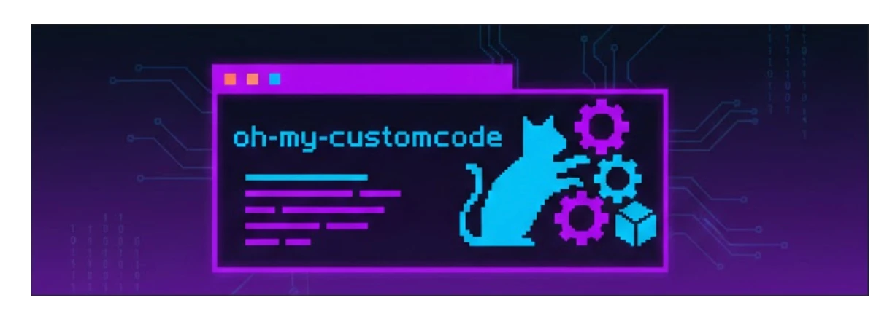
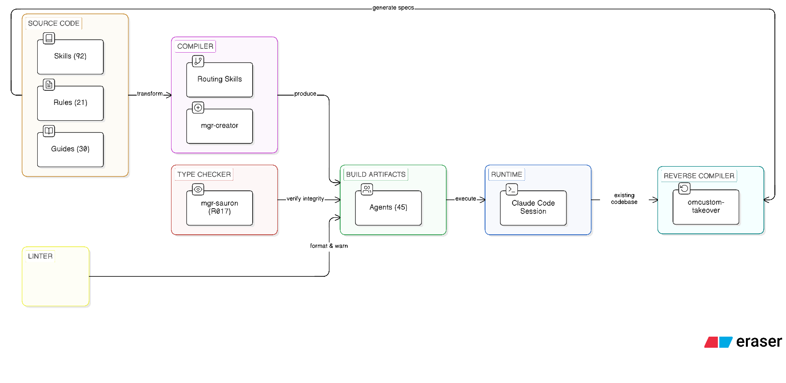
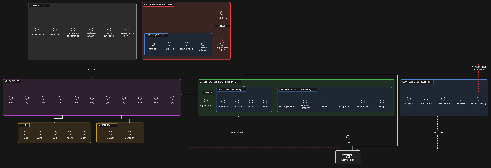

<div align="center">
  
</div>

# oh-my-customcode

> **AI 에이전트 스택. 설정이 아닌 컴파일.**

[](https://www.npmjs.com/package/oh-my-customcode)
[](https://polyformproject.org/licenses/noncommercial/1.0.0/)
[](https://github.com/baekenough/oh-my-customcode/actions/workflows/ci.yml)
[](https://github.com/baekenough/oh-my-customcode/actions/workflows/security-audit.yml)

**[English Documentation](./README.md)**

50개 에이전트. 114개 스킬. 23개 규칙. 명령어 하나.

```bash
npm install -g oh-my-customcode && cd your-project && omcustom init
```

---

## 철학

oh-my-customcode는 두 가지 아이디어 위에 세워졌습니다.

**1. 에이전트 시스템은 설정하는 게 아니라 컴파일한다.**

| 컴파일 개념 | oh-my-customcode |
|------------|-----------------|
| 소스코드 | `.claude/skills/` — 재사용 가능한 지식과 워크플로우 |
| 빌드 결과물 | `.claude/agents/` — 스킬을 조합한 실행 가능한 전문가 |
| 컴파일러 | `mgr-sauron` (R017) — 구조 검증과 정합성 보장 |
| 스펙 | `.claude/rules/` — 제약 조건과 빌드 규칙 |
| 링커 | Routing skills — 에이전트를 작업에 연결 |
| 표준 라이브러리 | `guides/` — 공유 레퍼런스 문서 |

스킬이 소스이고, 에이전트가 빌드 결과물이며, Sauron이 빌드를 검증합니다. 이 분리 덕분에 스킬은 에이전트와 독립적으로 진화하고, 에이전트는 갱신된 스킬로 언제든 재컴파일할 수 있습니다.

<p align="center">
  
</p>

**2. 안 되면 되게 한다.**

작업에 맞는 전문가가 없을 때, oh-my-customcode는 실패하지 않습니다. 만듭니다.

```
사용자: "이 Terraform 모듈을 리뷰해줘"
  → 라우팅: terraform 전문가 없음
  → mgr-creator가 탐색: infra-aws-expert 스킬 + docker-best-practices 가이드
  → 생성: infra-terraform-expert.md
  → 즉시 리뷰 실행
  → 에이전트는 이후 재사용을 위해 영속 저장
```

이것은 폴백이 아닙니다. 설계입니다. 시스템은 부족한 전문성을 빌드 문제로 취급합니다 — 적합한 스킬을 찾고, 새 에이전트를 컴파일하고, 실행합니다.

---

## 동작 방식

### 오케스트레이션

메인 대화가 싱글톤 오케스트레이터입니다 (R010). 파일을 직접 작성하지 않습니다. 모든 작업은 라우팅 스킬을 통해 전문 에이전트에 위임됩니다.

```
사용자 (자연어)
  → 라우팅 스킬 (의도 감지, 신뢰도 산출)
    → 전문 에이전트 (격리 실행)
      → 오케스트레이터에 결과 반환
        → 사용자에게 응답
```

4개의 라우팅 스킬이 전체 도메인을 커버합니다:

<p align="center">
  
</p>

| 라우팅 스킬 | 라우팅 대상 |
|------------|-----------|
| secretary-routing | 매니저 에이전트 (mgr-*), 시스템 에이전트 (sys-*) |
| dev-lead-routing | 언어, 백엔드, 프론트엔드, 툴링, DB, 인프라, 아키텍처 에이전트 |
| de-lead-routing | 데이터 엔지니어링 에이전트 (de-*) |
| qa-lead-routing | QA 팀 (qa-planner, qa-writer, qa-engineer) |

### 모델 선택

각 에이전트는 작업에 최적화된 모델로 실행됩니다:

| 모델 | 사용 시점 | 예시 |
|------|---------|------|
| `opus` | 복잡한 추론, 아키텍처 | 설계 리뷰, 리서치 종합 |
| `sonnet` | 구현, 일반 작업 | 코드 생성, 에이전트 생성 |
| `haiku` | 빠른 검증, 검색 | 파일 검색, 카운트 확인 |

Reasoning sandwich 패턴이 이를 공식화합니다: opus로 사전 분석, sonnet으로 구현, haiku로 사후 검증.

### 병렬 실행

독립 작업은 병렬로 실행됩니다 (R009). 메시지당 최대 4개 동시 에이전트:

```
Agent(lang-golang-expert):sonnet  ┐
Agent(lang-python-expert):sonnet  ├─ 하나의 메시지에서 동시 스폰
Agent(qa-engineer):sonnet         │
Agent(arch-documenter):haiku      ┘
```

소프트 기본값은 동시 에이전트 4개, 하드 캡은 5개입니다. Agent Teams(공유 작업 목록, 피어 메시징)를 사용할 수 있다면 단순 병렬 에이전트 대신 사용되지만, Claude Code가 `TeamCreate` 도구를 노출해야 하며 현재 기본 설치에는 이 도구가 존재하지 않습니다. 그전까지는 위의 oh-my-customcode 표준 Agent 도구 병렬 모델이 실제로 실행되는 방식입니다.

---

### 에이전트 (50개)

| 카테고리 | 수 | 에이전트 |
|---------|-----|---------|
| 언어 | 6 | lang-golang, lang-python, lang-rust, lang-kotlin, lang-typescript, lang-java |
| 백엔드 | 6 | be-fastapi, be-springboot, be-go-backend, be-express, be-nestjs, be-django |
| 프론트엔드 | 5 | fe-vercel, fe-vuejs, fe-svelte, fe-flutter, fe-design |
| 데이터 엔지니어링 | 6 | de-airflow, de-dbt, de-spark, de-kafka, de-snowflake, de-pipeline |
| 데이터베이스 | 4 | db-supabase, db-postgres, db-redis, db-alembic |
| 툴링 | 4 | tool-npm, tool-optimizer, tool-bun, slack-cli |
| 아키텍처 | 2 | arch-documenter, arch-speckit |
| Agora | 1 | agora-runner |
| 인프라 | 2 | infra-docker, infra-aws |
| QA | 3 | qa-planner, qa-writer, qa-engineer |
| 보안 | 1 | sec-codeql |
| 매니저 | 6 | mgr-creator, mgr-updater, mgr-supplier, mgr-gitnerd, mgr-sauron, mgr-claude-code-bible |
| 시스템 | 4 | sys-memory-keeper, sys-naggy, tracker-checkpoint, wiki-curator |

각 에이전트는 YAML 프론트매터에 도구, 모델, 메모리 스코프, 한계를 선언합니다. 에이전트 유형별 도구 예산이 정확도를 위해 강제됩니다.

---

### 스킬 (114개)

| 카테고리 | 수 | 포함 |
|---------|-----|------|
| 베스트 프랙티스 | 24 | Go, Python, TypeScript, Kotlin, Rust, React, FastAPI, Spring Boot, Django, Flutter, Docker, AWS, Postgres, Redis, Kafka, dbt, Spark, Snowflake, Airflow, pipeline-architecture-patterns, alembic 외 |
| 라우팅 | 4 | secretary, dev-lead, de-lead, qa-lead |
| 워크플로우 | 14 | structured-dev-cycle, deep-plan, research, evaluator-optimizer, dag-orchestration, worker-reviewer-pipeline, reasoning-sandwich, pipeline, fsd 외 |
| 개발 | 8 | dev-review, dev-refactor, analysis, create-agent, intent-detection, web-design-guidelines, omcustom-takeover, skill-extractor |
| 운영 | 9 | update-docs, audit-agents, sauron-watch, monitoring-setup, fix-refs, release-notes 외 |
| 메모리 | 3 | memory-save, memory-recall, memory-management |
| 패키지 | 3 | npm-publish, npm-version, npm-audit |
| 최적화 | 3 | optimize-analyze, optimize-bundle, optimize-report |
| 보안 | 2 | adversarial-review, cve-triage |
| 합의 | 1 | agora — 익명 다중 라운드 다중 벤더 합의 리뷰 |
| 기타 | 43 | claude-native, vercel-deploy, skills-sh-search, result-aggregation 외 39개 |

스킬은 3-tier scope 시스템을 사용합니다: `core` (범용), `harness` (에이전트/스킬 관리), `package` (프로젝트 특화).

---

## 커맨드

모든 커맨드는 Claude Code 대화 내에서 호출합니다.

### 개발

| 커맨드 | 기능 |
|--------|------|
| `/dev-review` | 베스트 프랙티스 기반 코드 리뷰 |
| `/dev-refactor` | 구조와 패턴 개선 리팩토링 |
| `/structured-dev-cycle` | 6단계 개발: plan → verify → implement → verify → compound → done |
| `/deep-plan` | 연구 검증 기반 계획 수립 |
| `/research` | 10-team 병렬 분석 및 교차 검증 |
| `/sdd-dev` | Spec-Driven Development 워크플로우 |
| `/ambiguity-gate` | 사전 라우팅 모호성 분석 |
| `/adversarial-review` | 공격자 관점 보안 코드 리뷰 |
| `/pipeline` | YAML 파이프라인 실행 |
| `/pipeline resume` | 마지막 실패 지점부터 중단된 파이프라인 재개 |
| `/omcustom:fsd` | Full Self Driving — 자율 릴리즈 루프: 적격 이슈가 남지 않을 때까지 `/pipeline auto-dev`(이슈 → 구현 → 검증 → 릴리즈)와 `/homework`(회고 감사)를 반복 실행 |
| `/homework` | 현재 세션에 대한 회고 감사 — 프로세스 공백을 피드백/이슈로 표면화 |
| `/agora` | 적대적 검토가 필요한 결정을 위한 익명 다중 라운드·다중 벤더 합의 리뷰 (독립 CLI 리뷰어 + 순환 심사자) |

### 에이전트 관리

| 커맨드 | 기능 |
|--------|------|
| `/omcustom:analysis` | 프로젝트 분석, 에이전트·스킬 자동 구성 |
| `/omcustom:create-agent` | 새 에이전트 생성 |
| `/omcustom-takeover` | 기존 에이전트/스킬에서 canonical spec 추출 |
| `/omcustom:audit-agents` | 에이전트 의존성 감사 |
| `/omcustom:update-docs` | 프로젝트 구조와 문서 동기화 |
| `/omcustom:sauron-watch` | 전체 구조 검증 (5+3 라운드) |
| `/omcustom-feedback` | 피드백을 GitHub 이슈로 등록 |

### Web UI

| 커맨드 | 기능 |
|--------|------|
| `/omcustom:web` | 내장 Web UI 제어 (start, stop, status, open) |

### 패키지 & 릴리즈

| 커맨드 | 기능 |
|--------|------|
| `/omcustom:npm-publish` | npm 배포 |
| `/omcustom:npm-version` | 시맨틱 버전 관리 |
| `/omcustom:npm-audit` | 의존성 보안 감사 |
| `/omcustom-release-notes` | git 히스토리 기반 릴리즈 노트 생성 |

### 메모리 & 시스템

| 커맨드 | 기능 |
|--------|------|
| `/omcustom:monitoring-setup` | OTel 모니터링 토글 |
| `/omcustom-loop` | 백그라운드 에이전트 작업 중 SubagentStop 권고 훅 (결과 기록, 연속 완료 권고) |
| `/omcustom:lists` | 전체 커맨드 표시 |
| `/omcustom:status` | 시스템 상태 확인 |

---

### 규칙 (23개)

| 우선순위 | 수 | 목적 |
|---------|-----|------|
| **MUST** | 14 | 안전, 권한, 에이전트 설계, 식별, 오케스트레이션, 검증, 완료 검증, 집행 정책 |
| **SHOULD** | 8 | 상호작용, 오류 처리, 메모리, HUD, ecomode, ontology 라우팅, 위키 동기화, 검증 사다리 |
| **MAY** | 1 | 최적화 |

핵심 규칙: R010 (오케스트레이터는 파일을 직접 쓰지 않음), R009 (병렬 실행 의무), R017 (푸시 전 sauron 검증), R020 (완료 선언 전 검증 의무), R021 (어드바이저리 우선 집행 — 대부분의 규칙은 프롬프트 기반이며 하드 블록되지 않음), R016 (지속적 개선 — 위반은 규칙을 갱신시키고, 낡은 조항은 무한히 누적되는 대신 HTML 주석으로 은퇴함), R023 (검증 사다리 — 가장 저렴한 검사부터: 결정론적 훅/린터 → 저비용 모델 리뷰 → 고비용 모델 리뷰 → 사람).

R018 (Agent Teams)은 조건부입니다: `CLAUDE_CODE_EXPERIMENTAL_AGENT_TEAMS=1`이 설정되어 있고 동시에 `TeamCreate` 도구가 도구 목록에 존재할 때만 효력을 갖습니다. 현재 기본 Claude Code 설치에서는 `TeamCreate`가 등록되어 있지 않으므로 R018은 비활성 상태이며, 그 대신 R009/R010(표준 Agent 도구 병렬 실행 모델)이 적용됩니다.

---

### 가이드 (56개)

베스트 프랙티스, 아키텍처 결정, 통합 패턴을 다루는 레퍼런스 문서입니다. 프로젝트 루트의 `guides/`에 위치하며, 에이전트 설계부터 CI/CD, 관측성까지 다양한 주제를 다룹니다.

---

## 보안

oh-my-customcode는 보안, 드리프트 감지, 규칙 강화를 다루는 42개의 라이프사이클 훅 스크립트를 제공합니다. 몇 가지 예시:

| 훅 | 트리거 | 동작 |
|----|--------|------|
| secret-filter | Bash, Read, Grep 출력 | AWS 키, API 토큰, 개인 키, bearer 토큰 감지 |
| audit-log | Edit, Write, Bash, Agent | `~/.claude/audit.jsonl`에 append-only JSONL 기록 |
| schema-validator | Write, Edit, Bash 입력 | 도구 입력 검증, 위험 패턴 플래그 |
| claude-md-reinject | SessionStart (compact 재진입 시에만) | 압축 후 CLAUDE.md(강제 규칙 표 포함)를 재주입 — 규칙 망각 방지 |
| stuck-detector | PostToolUse, 반복 편집 | 에이전트가 진행 없이 같은 파일/편집을 반복하면 플래그 |
| r007-r008-drift-advisor | UserPromptSubmit, SubagentStop, PostToolUse | 직전 턴이 필수 에이전트/도구 식별 헤더를 포함했는지 확인하는 어드바이저리 체크 |

대부분의 훅은 어드바이저리(exit 0)입니다 — 경고만 하고 절대 차단하지 않습니다. 소수의 하드 블록 훅(예: `stage-blocker`, `rule-deletion-guard`)은 도구 호출 자체를 거부합니다(exit 2). 세 번째 그룹인 `stuck-detector`, `context-budget-advisor`, `cost-cap-advisor`는 `continueOnBlock`이 설정된 PostToolUse 훅으로 실행됩니다. 임계값에 도달하면 exit 2로 종료하지만 도구 호출은 이미 실행된 뒤이므로, 사유가 대화로 피드백되고 세션은 계속됩니다. oh-my-customcode 자체의 거버넌스 규칙(`.claude/rules/`)은 **어드바이저리 우선 집행 모델**을 따릅니다: 프롬프트 기반 가이드가 기본이며, 규칙이 차단 훅으로 승격되는 것은 반복적으로 관측된 위반이 있을 때뿐입니다. 규칙은 은퇴하기도 합니다 — 이미 수정된 플랫폼 버그에 묶인 조항이나 두 마이너 릴리즈 동안 발동되지 않은 조항은 무한히 누적되는 대신 HTML 주석으로 감싸집니다(소스 파일을 통해 여전히 읽을 수 있지만 에이전트의 컨텍스트에는 보이지 않음).

훅의 소스 오브 트루스는 `.claude/hooks/hooks.json`입니다. `omcustom init`은 이를 `src/core/hooks-settings.ts`를 통해 `.claude/settings.local.json`의 `hooks` 블록으로 병합하며, 이 파일은 Claude Code가 실제로 로드하는 settings 파일 중 하나입니다. 이 저장소가 자체적으로 추적하는 `.claude/settings.json`(및 `templates/` 미러)은 `sync:hooks` 생성기가 별도로 생성합니다. 훅 명령은 `bash "${CLAUDE_PROJECT_DIR:-.}/.claude/hooks/<path>"` 형태로 고정되어 있으므로, 세션의 작업 디렉터리가 하위 디렉터리로 이동해도 훅이 계속 동작합니다. 기여자는 settings의 `hooks` 블록을 직접 수정하지 말고, `hooks.json`을 수정한 뒤 `bun run sync:hooks`(`bun run build` 마지막에도 실행됨)로 재생성해야 합니다. 기존 설치본은 별도 조치가 필요 없습니다. `omcustom update`(전체 또는 hooks 컴포넌트)와 `omcustom init --backup`이 `.claude/settings.local.json`의 이전 상대 경로 훅 명령을 자동으로 마이그레이션하며, 사용자 정의 훅은 건드리지 않습니다. 기존 `.claude/settings.local.json`에 대해 `omcustom init`을 다시 실행하면 훅을 교체하지 않고 병합합니다. omcustom 소유 훅 그룹은 갱신되고, 사용자 고유의 훅 그룹, 사용자 전용 훅 이벤트, 그 밖의 모든 settings 키는 보존됩니다(선행 BOM은 유지되며, `init`은 항상 2칸 들여쓰기, LF 줄바꿈, 끝 개행으로 파일을 다시 쓰고, `--backup` 복원 경로는 사용자 파일 고유의 끝 개행 관례를 유지합니다). 기존 파일을 JSON 객체로 파싱할 수 없으면 바이트 단위로 그대로 두며, `init`은 훅이 설치되지 않았다는 경고를 출력합니다.

---

## CLI

```bash
omcustom init                  # 인터랙티브 설정 마법사 (언어, 프레임워크, 팀 모드)
omcustom init --lang ko        # 한국어로 초기화
omcustom init --from-snapshot  # 사전 구성된 팀 스냅샷에서 설치
omcustom init --no-agent-teams # Agent Teams env 플래그를 기록하지 않음
omcustom sync                  # .claude/ 상태와 lockfile 간 드리프트 감지
omcustom sync --check          # 변경 없이 드리프트 확인
omcustom sync --export         # 현재 상태를 팀 스냅샷으로 내보내기
omcustom update                # 최신 버전 업데이트
omcustom update --yes          # 잔존 파일 백업 확인 없이 업데이트 (orphan retirement)
omcustom list                  # 컴포넌트 목록
omcustom doctor                # 설치 상태 검사
omcustom doctor --fix          # 문제 자동 수정
omcustom security              # 보안 이슈 스캔
omcustom projects              # 관리 프로젝트 목록 및 버전 상태
omcustom update --all          # 모든 구버전 프로젝트 일괄 업데이트
omcustom serve                 # 내장 Web UI 시작
omcustom serve-stop            # Web UI 중지
```

- **Agent Teams 플래그**: 기본적으로 `init`은 프로젝트 `.claude/settings.json`에 `env.CLAUDE_CODE_EXPERIMENTAL_AGENT_TEAMS = "1"`을 기록합니다. 다른 키와 env 항목은 유지되며, 해당 키의 기존 값은 절대 덮어쓰지 않습니다. JSON 객체가 아닌 파일은 건드리지 않고 `init`이 경고를 출력합니다. `--no-agent-teams`는 아무것도 기록하지 않으며, `--from-snapshot`에는 적용되지 않습니다(팀의 settings를 그대로 복사). 이는 기본값이 `false`인 `.omcustomrc.json`의 `teamMode`와 별개입니다. 이 변수는 의도만 표현합니다. Agent Teams는 사용 중인 Claude Code 버전이 Agent Teams 도구를 제공할 때만 동작합니다.
- **init 배너와 자체 업데이트**: init 배너에 CLI 버전(`oh-my-customcode vX.Y.Z`)이 표시됩니다. `omcustom init`과 `omcustom update`는 작업을 시작하기 전에 항상 npm에서 최신 CLI를 확인합니다. 매번 새로 조회하며(24시간 캐시 없음), 프롬프트 없이 TTY와 비TTY에서 동일하게 동작합니다. 더 새로운 버전이 있으면 `npm install -g oh-my-customcode@<latest>`를 실행하고 설치된 바이너리의 버전을 확인한 뒤, `OMCUSTOM_SKIP_SELF_UPDATE=true`를 설정해 같은 명령을 다시 실행합니다. 종료 코드는 자식 프로세스의 것입니다. 새 버전을 `--version`으로 실행해 기대한 버전이 보고될 때만 다시 실행하며, 그렇지 않으면 다시 실행하지 않고 `npm install -g oh-my-customcode@latest`를 언급하는 안내를 한 줄 출력한 뒤 현재 버전으로 계속 진행합니다. npx로 실행한 경우에는 전역 설치 대신 확인된 버전(`npx -y oh-my-customcode@<version>`)으로 다시 실행합니다. 실행 중인 CLI가 `npm root -g` 아래에 있지 않으면(pnpm/bun/volta로 설치했거나 bunx/pnpm dlx로 실행한 경우) 설치하지 않고 설치한 도구로 업데이트하라는 안내를 한 줄 출력합니다(npm 명령이 아니라 `--skip-self`를 언급합니다). 조회, 설치 또는 재실행이 실패하면 `npm install -g oh-my-customcode@latest`와 `--skip-self`를 언급하는 안내를 한 줄 출력하고 계속 진행합니다(치명적 오류가 아닙니다). 비어 있지 않은 `CI`, `GITHUB_ACTIONS`, `TF_BUILD` 중 값이 `false`/`0`이 아닌 것이 있으면(`CI=1`, `CI=True`도 해당하며 `CI=false`/`CI=0`은 CI가 아닙니다), 또는 `OMCUSTOM_SKIP_SELF_UPDATE=true`, 전역 `--skip-version-check`, `--skip-self`(`init`과 `update` 모두에서 사용 가능)인 경우에는 자체 업데이트를 건너뜁니다. `update --dry-run`도 자체 업데이트를 건너뛰며 그 사실을 알립니다.
- **백업(`--backup`)**: 백업은 `.claude`를 `claude/`로, `CLAUDE.md`를 `CLAUDE.md.backup`으로 저장하므로 백업의 최상위 `.claude`와 `CLAUDE.md`는 더 이상 활성 Claude Code 설정으로 로드되지 않습니다. 백업(`--backup` 사본과 `retired/` 폴더 모두) 안의 모든 깊이에 있는 `CLAUDE.md`, `CLAUDE.local.md`, `AGENTS.md`에는 대소문자를 구분하지 않고 `.backup` 접미사가 붙습니다. `--backup` 사본에서는 같은 폴더에 그 이름이 이미 있으면 아무것도 덮어쓰지 않고 `.backup-1`, `.backup-2`, …로 저장하며, `retired/`에서는 이름이 충돌하면 해당 이동이 실패하고 원본은 제자리에 남으며 경고가 출력됩니다. 복원할 때는 충돌하지 않은 파일에 한해 접미사 전체를 제거하십시오. CLI는 복원용 이름 변경(`CLAUDE.md.backup -> CLAUDE.md`, `claude -> .claude`)을 출력하며 중첩된 `*.md.backup` 파일도 안내합니다. 충돌한 `--backup` 파일(`.backup-1` 등으로 저장된 파일)은 안내가 각각 `<path>.backup-N -> <path>`로 명시하며, 바로 옆의 기존 `.backup` 파일은 사용자의 것이므로 그대로 남는다고 알려줍니다. `update` 백업은 `.omcustom-backup-<timestamp>/`, `init` 백업은 `.claude-backup-<timestamp>/`를 사용합니다. 이러한 디렉터리가 git 작업 트리 안에 있고 무시되지 않으면, `init`/`update`가 `# oh-my-customcode backups`와 `.omcustom-backup-*/`(init 백업은 `.claude-backup-*/`도)를 `.gitignore`에 추가하며, 파일이 없으면 생성합니다. 백업 디렉터리가 무시되는지는 git 자체(`git check-ignore`)가 판단하므로 `.gitignore`, `.git/info/exclude`, 전역 excludes 파일의 `!` 부정 규칙이 존중됩니다. 접두사(`.omcustom-backup-`, `.claude-backup-`)마다 따로 판단하며, git이 답하지 못하면 `.gitignore` 텍스트를 대신 검사합니다. 여러 번 실행해도 결과는 같고 `--dry-run`에서는 아무것도 기록하지 않습니다. CRLF `.gitignore`는 CRLF를 유지하며, 마지막 줄바꿈이 없으면 같은 줄바꿈 형식으로 추가합니다.
- **스킬 범위**: `update`는 `init`과 같은 범위 규칙을 따릅니다. package 범위 스킬 6개(`diagram-design`, `monitoring-setup`, `npm-audit`, `npm-publish`, `npm-version`, `token-efficiency-audit`)는 아직 없는 프로젝트에 설치되지 않으며, 이미 설치된 스킬은 유지되고 계속 업데이트됩니다. 설치된 `CLAUDE.md`의 스킬 수는 `.claude/skills`에 실제로 있는 숨김이 아닌 하위 디렉터리 수(사용자가 만든 스킬과 심볼릭 링크된 스킬 디렉터리 포함, 파일과 깨진 링크는 제외)를 표시하며, `init --backup`은 보존된 파일을 복원한 뒤 다시 계산합니다. 이 수를 갱신하지 못해도 설치는 경고와 함께 성공합니다.
- **ontology-rag MCP**: npm 패키지에 ontology-rag Python 소스가 포함되므로 `omcustom init`이 npm 설치 상태에서도 ontology-rag MCP를 설치할 수 있습니다. npm 설치에서는 non-editable로 설치되어(이후 npm 업그레이드나 제거가 프로젝트 `.venv`를 손상시키지 않습니다), 저장소 체크아웃에서는 editable로 유지됩니다. Python 3.10 이상이 필요하며, 선택 사항인 Rust 확장은 번들 설치에서 사용할 수 없습니다. 소스가 없으면 venv를 만들지 않고 건너뛰며 수동 설치 안내를 출력합니다. `omcustom update`는 이미 ontology-rag가 설치된 프로젝트 `.venv`에 번들 소스를 다시 설치하되, 전체 update에서만 실행합니다(`--agents` 같은 컴포넌트 플래그를 쓰거나 이미 최신이면 실행하지 않으며, `--force`를 쓰면 이미 최신일 때의 조기 반환을 건너뜁니다). venv는 만들지 않으며, 실패는 경고만 하고, `--dry-run`은 아무것도 설치하지 않습니다.
- **잔존 파일**: `omcustom update`는 이전 버전에서 남은 파일을 다음 조건을 모두 만족할 때만 백업으로 이동합니다(삭제하지 않습니다): 경로가 `templates/retired-template-paths.json`(oh-my-customcode가 과거에 배포한 파일)에 있고, 내용이 배포된 버전과 일치하며, 이전 lockfile이 같은 hash로 해당 파일을 소유하고, 경로가 preserve 설정에 없어야 합니다. 그렇지 않으면 파일은 유지됩니다. 수정된 잔존 파일과 소유권을 증명할 수 없는 잔존 파일은 경고와 함께 유지됩니다. preserve 설정이나 customization manifest의 `modifiedFiles`에 포함된 파일, 그리고 확인 질문에서 거절한 파일은 조용히 유지되며, `update`가 개수를 한 줄로 출력합니다. `templates/deprecated-files.json`에 나열된 파일도 확인 질문 없이 같은 백업으로 이동됩니다(삭제하지 않습니다). 이 목록의 심볼릭 링크나 디렉터리는 경고와 함께 유지되고, preserve 설정에 포함된 항목은 조용히 유지되며, 읽을 수 없는 customization manifest가 있으면 경고와 함께 파일을 유지합니다. 로그에는 파일이 이동된 백업 경로가 표시되며, `--dry-run`은 실제 실행이 이동할 대상을 정확히 나열합니다(preserve된 항목, 없는 항목, 안전하지 않은 위치의 항목은 제외). 한 번의 update 실행은 첫 이동 시 만들어지는 프로젝트 루트의 백업 폴더 하나 `.omcustom-backup-<timestamp>/retired/`를 사용하며, 이동은 기존 파일을 덮어쓰지 않고 실패하면 원본을 유지합니다. 이미 최신인 프로젝트라도 여러 프로젝트가 등록되어 있을 때 해당 프로젝트 디렉터리에서 `omcustom update`를 실행하면 이 정리가 수행됩니다. 폴더 안에서 맨 앞의 `.claude/` 폴더는 `claude/`로 저장되므로 Claude Code가 백업된 스킬이나 에이전트를 로드하지 않습니다. 파일을 복원하려면 같은 경로로 다시 옮기십시오(백업의 `claude/`는 `.claude/`를 뜻하며 CLAUDE.md / CLAUDE.local.md / AGENTS.md는 `.backup` 접미사를 제거합니다. CLI 안내도 같은 내용입니다). 복원한 파일은 더 이상 oh-my-customcode가 설치한 파일로 추적되지 않으므로 업데이트할 때마다 경고가 나오고 `omcustom doctor`는 삭제를 권장합니다. 계속 사용하려면 `.omcustomrc.json`의 `preserveFiles`에 해당 경로를 추가하십시오. 그러면 업데이트가 조용히 유지합니다. 아래 확인 질문에 아니오로 답하고 다시 묻지 않게 하면서 파일을 유지하려는 경우에도 같은 곳에 경로를 추가하십시오. 같은 실행에서 `--backup`도 사용하면 파일은 해당 실행의 백업 폴더 안 `retired/`로 이동됩니다. 사용하지 않은 경우(예: 업데이트할 구성 요소가 없을 때) 백업 폴더에는 `retired/`만 들어 있습니다. `--dry-run`은 이동 대상을 나열하며 아무것도 생성하지 않고, 이동으로 비게 된 디렉터리는 삭제됩니다. 대화형 터미널에서는 `omcustom update`가 파일을 나열하고 백업으로 이동할지 확인을 요청합니다. 기본 답은 아니오이므로 파일은 유지되며 다음 업데이트에서 다시 묻습니다. `--yes`, `--all`, 비대화형 실행(TTY 없음), CI에서는 묻지 않고 자동으로 이동합니다. `--dry-run`은 묻지 않습니다. `.omcustom-backup-*` 폴더는 `.gitignore`에 자동으로 추가됩니다(위 백업 항목 참조).
- **Orphans 검사**: `omcustom doctor`는 이러한 잔존 파일을 나열하고, 각 파일마다 `omcustom update`가 백업으로 이동하는지 직접 처리해야 하는지(lockfile 미소유, preserve 지정, 수정됨)를 알려줍니다. lockfile은 템플릿 파일과 이미 소유하던 retired 파일을 기록하지만, 소유한 적 없는 잔존 파일(예: 이전 설치 위에 init을 다시 실행해 남은 파일)은 기록하지 않으므로, "lockfile OK"만으로는 잔존 파일이 없다는 증거가 되지 않습니다.

### 문제 해결: `init`이 구버전을 설치하는 경우

매우 오래된 CLI(예: 0.148.0, 또는 1.0.16보다 오래된 버전)는 1.x 이상 릴리스를 감지하지 못하고 이번 변경을 넘어 스스로 업데이트할 수도 없으므로, `omcustom init`이 조용히 구버전을 설치합니다. `npm install -g oh-my-customcode@latest`를 한 번 실행하십시오. 이번 릴리스부터는 `init`과 `update`가 스스로 최신 상태를 유지합니다. 그런 다음 `omcustom --version`으로 확인하십시오. 버전이 바뀌지 않으면 PATH의 `omcustom`이 다른 npm prefix에서 온 것입니다. `which -a omcustom`과 `npm prefix -g`를 비교하십시오.

---

## 프로젝트 구조

```
your-project/
├── CLAUDE.md                   # 진입점
├── .claude/
│   ├── agents/                 # 50개 에이전트 정의
│   ├── skills/                 # 114개 스킬 모듈
│   ├── rules/                  # 23개 거버넌스 규칙 (R000-R023)
│   ├── hooks/                  # 42개 라이프사이클 훅 스크립트 (hooks.json이 소스; settings.json으로 컴파일됨)
│   ├── schemas/                # 도구 입력 검증 스키마
│   ├── specs/                  # 추출된 canonical spec
│   ├── contexts/               # 4개 공유 컨텍스트 파일
│   └── ontology/               # RAG용 지식 그래프
└── guides/                     # 56개 레퍼런스 문서
```

---

## 외부 도구 통합

v1.1.107부터 프로젝트 RTK 통합을 퇴역합니다. 공개 `/rtk-exec` 스킬, 자동 설치, doctor 연결 및 RTK 훅을 제거하며 머신에 별도로 설치한 RTK 바이너리는 유지합니다. `omcustom update`는 실행할 때마다 백업 없이 RTK 잔존 파일을 삭제합니다. 대상은 `.claude/skills/rtk-exec/` 디렉터리 전체와 `.claude/hooks/scripts/rtk-intercept.sh`이며, lock 소유권, 로컬 수정, preserve 설정(`preserveFiles`, customization manifest, 사용자 정의 구성 요소), settings 충돌, 선택한 구성 요소(`--agents`, `--skills`, …)와 무관합니다(전체 실행, 구성 요소 제한 실행, 이미 최신인 실행 모두 동일). 삭제 전에 `.claude/settings.json`과 `.claude/settings.local.json`에서 프로젝트 RTK 스크립트만 실행하는 모든 훅 명령(선택적 `bash `, 선택적 따옴표, 프로젝트 상대 경로, `./…`, `$CLAUDE_PROJECT_DIR`, `${CLAUDE_PROJECT_DIR}`, `${CLAUDE_PROJECT_DIR:-.}`로 시작하는 경로(따옴표 유무 무관), 또는 프로젝트 절대 경로로 지정한 스크립트)를 이벤트나 matcher와 관계없이 제거하고 다른 설정은 모두 유지합니다. 프로젝트 스크립트를 다른 것(다른 명령, 인자, 파이프, 환경 변수 할당)과 함께 실행하는 명령은 유지되며, 경고에는 이벤트, matcher, 스크립트 경로만 표시합니다(전체 명령, 인자, `NAME=value`는 표시하지 않습니다). 이 명령은 직접 수정할 때까지 실행할 때마다 보고됩니다("will fail once the script is deleted"). 다른 위치의 `rtk-intercept.sh`만 실행하는 훅은 유지되며, 파일이 변경된 실행에서 한 번 안내합니다. 파싱할 수 없는 settings 파일은 건드리지 않으며 파일 삭제는 그대로 진행합니다. 심볼릭 링크는 따라가지 않고 링크만 해제하며, 상위 경로가 프로젝트 밖으로 해석되는 대상은 경고와 함께 건너뛰고, 삭제에 실패하면 다음 실행에서 다시 시도합니다. 수정되었거나 preserve된 파일을 삭제하면 경고("RTK is retired: deleted <path> although it was …")를 출력하며, `--dry-run`은 이를 "would delete"로 나열합니다. 다른 도구는 선택입니다:

| 도구 | 용도 | 설치 | 상태 |
|------|------|------|------|
| [Codex CLI](https://github.com/openai/codex) | OpenAI Codex 하이브리드 워크플로우 | `npm i -g @openai/codex` | 선택 |
| [Gemini CLI](https://github.com/google-gemini/gemini-cli) | Google Gemini 하이브리드 워크플로우 | `npm i -g @google/gemini-cli` | 선택 |

설치된 도구는 세션 시작 시 **자동 감지**되며 관련 기능이 활성화됩니다. 미설치 시 모든 명령어는 Claude 네이티브 대안으로 자연스럽게 폴백됩니다.

---

## 개발

```bash
bun install          # 의존성 설치
bun run dev          # 개발 모드
bun test             # 테스트 실행
bun run build        # 프로덕션 빌드
```

요구사항: Node.js >= 18.0.0, Claude Code CLI (Claude Code v2.1.277 기준으로 개발 및 테스트됨).

릴리즈는 2단계 자동화로 이루어집니다: 머지된 `release/vX.Y.Z` PR이 `auto-tag.yml`을 트리거해 git 태그를 생성하고, 그 태그 푸시가 다시 `release.yml`을 트리거해 빌드·검증·npm 배포를 수행합니다. 이 프로젝트 자체의 기여자 지식 베이스 — 에이전트, 스킬, 규칙, 워크플로우를 다루는 저장소 내 `wiki/` 디렉토리 — 는 모든 PR에서 source-hash 매니페스트와 대조하여 CI로 검증되므로, 위키 페이지가 그것이 설명하는 코드로부터 조용히 drift될 수 없습니다.

---

## 후원

oh-my-customcode가 시간을 아껴드렸거나 방향이 마음에 드신다면, 개발을 후원해 주세요:

[](https://github.com/sponsors/baekenough)

여러분의 후원이 컴파일러를 계속 돌아가게 합니다. ☕

---

## 라이선스

이 프로젝트는 **[PolyForm Noncommercial License 1.0.0](LICENSE)** 라이선스를 따릅니다.

**비상업적** 목적(개인 프로젝트, 연구, 교육, 비영리/정부 용도)에 한해 자유롭게 **사용·수정·배포**할 수 있습니다. 본 라이선스에서 **상업적 이용은 허용되지 않습니다**.

상업용 라이선스가 필요하시면 이슈를 열거나 작성자에게 문의해 주세요.

---

<p align="center">
  <strong>전문가가 없으면? 만들고, 지식을 연결하고, 실행한다.</strong>
</p>

<p align="center">
  Made with care by <a href="https://github.com/baekenough">baekenough</a>
</p>
